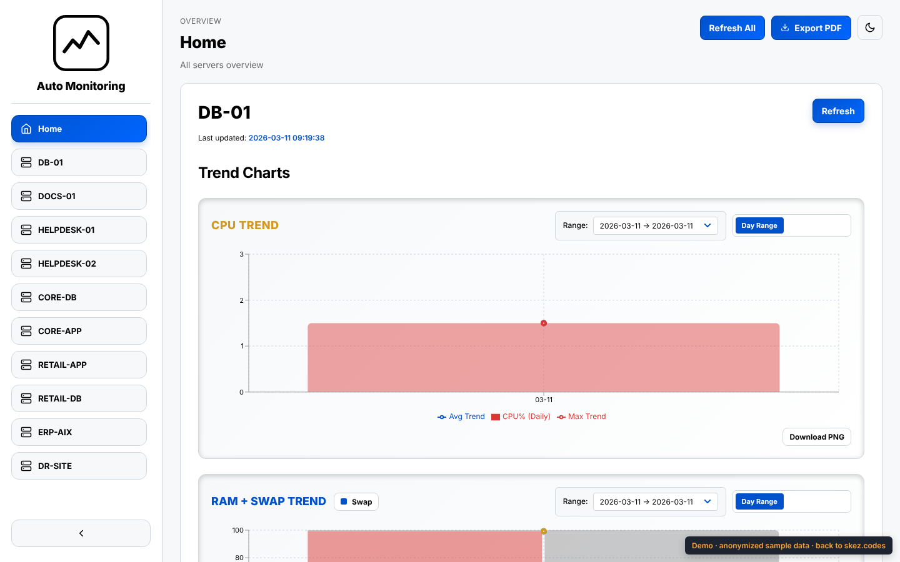
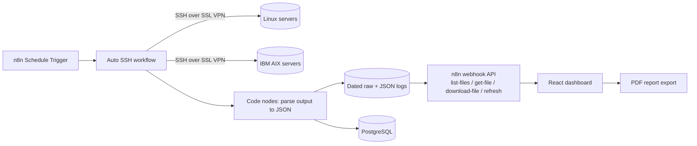

# Automate Daily Monitoring

**Live demo:** [skez.codes/demo/monitoring](https://skez.codes/demo/monitoring/) (runs in the browser on anonymized sample data)

An automation platform that replaced a manual, Excel-based morning health check of client production servers. It was built during my Cloud Engineer internship at A-HOST Co., Ltd. (System Management Service), Nov 2025 – Mar 2026, as the sole developer.

| | Before | After |
|---|---|---|
| Morning check, all servers | 1–2 hours, by hand | ~5 minutes |
| Data entry | copied into Excel | parsed to JSON automatically |
| History | scattered spreadsheets | dated logs + PostgreSQL, trend charts |



## How it works



1. **Collect.** A scheduled n8n workflow connects to every server over SSH (through FortiClient SSL VPN) and runs `df -h`, `top`/`topas`, Oracle tablespace queries, AIX `errpt`, process checks and backup-log checks.
2. **Parse.** JavaScript Code nodes turn each command's inconsistent text output into structured JSON. Raw and JSON files are stored by `server/table/yyyy/mm`.
3. **Serve.** Webhook workflows expose a small REST API (`list-files`, `get-file`, `download-file`, `refresh`).
4. **Show.** A React + Vite dashboard reads that API: color-coded health thresholds (for example disk > 90%), trend charts, history comparison, raw/JSON download and one-click PDF reports.

## What is in this repo

| Path | What |
|---|---|
| `n8n/workflows/` | Exported n8n workflows: Auto SSH (146 nodes), webhook file API, Auto tuning, Daily Schedule |
| `n8n/custom-nodes/n8n-nodes-aix/` | Custom n8n node in TypeScript (ssh2) that captures non-interactive AIX `topas` output, which the built-in SSH node could not do |
| `dashboard/` | React 18 + Vite dashboard (Recharts, jsPDF), ESLint + Prettier, multi-stage Dockerfile with Nginx |
| `deploy/` | Docker Compose for n8n behind an Nginx reverse proxy, and the GitHub Actions deploy workflow (self-hosted Windows runner) |
| `docs/` | System documentation, API reference, flow diagrams |
| `sample-data/` | Anonymized sample outputs used by the demo |

## Run it

**Dashboard demo (no n8n needed):**
```bash
cd dashboard
npm ci
python3 scripts-make-demo-data.py      # builds public/demo-data from ../sample-data
VITE_DEMO=true npm run dev              # http://localhost:3000
```

**Full stack:**
```bash
cd deploy
echo "N8N_ENCRYPTION_KEY=$(openssl rand -hex 24)" > .env
docker compose up -d                    # n8n on :5678 behind Nginx
```
Then import `n8n/workflows/*.json` in n8n, create one SSH credential per server (the exported credentials are placeholders named `REPLACE_ME`), and point the dashboard at n8n with `VITE_API_WEBHOOK_HOST`.

## Anonymization

This is a public copy of internal work, so:
- Client and server names are replaced with neutral names (`ERP-AIX`, `DB-01`, `DR-SITE`, ...), consistently across code, workflows and sample data.
- Internal IPs, hostnames, credential IDs, the n8n encryption key, company logos and raw command output are removed.
- Sample data for some servers is copied from a similar server with shifted numbers, so every screen has something to show.

## Stack

n8n · Docker · Docker Compose · Nginx · GitHub Actions · SSH / SSL VPN · Linux · IBM AIX · Oracle · PostgreSQL · JavaScript · TypeScript · React · Vite · Recharts · jsPDF

## Author

Tham Kaeoket · [skez.codes](https://skez.codes) · [github.com/5kez](https://github.com/5kez)
